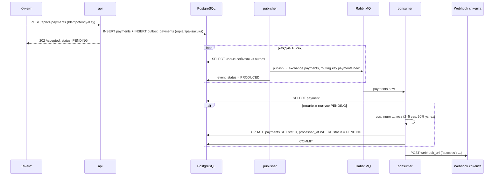
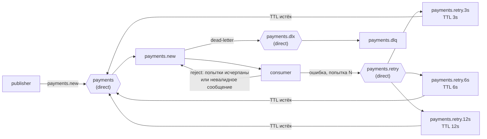

# Payments Service

Микросервис асинхронного процессинга платежей. Принимает запросы на оплату, обрабатывает их через эмуляцию
платёжного шлюза и уведомляет клиента о результате через webhook.

**Стек:** Python 3.12, FastAPI, Pydantic v2, SQLAlchemy 2.0 (async, asyncpg), PostgreSQL, RabbitMQ (FastStream),
Alembic, [python-cqrs](https://github.com/vadikko2/python-cqrs) (медиатор и outbox), Docker Compose.

## Содержание

- [Быстрый старт](#быстрый-старт)
- [API](#api)
- [Как это работает](#как-это-работает)
- [Структура проекта](#структура-проекта)
- [Конфигурация](#конфигурация)
- [Локальная разработка](#локальная-разработка)
- [Тесты](#тесты)

## Быстрый старт

Нужны Docker и Docker Compose v2.

```bash
cp .env.example .env
docker compose up -d --build
```

Поднимутся контейнеры:

| Сервис       | Назначение                                                   | Порт на хосте          |
|--------------|--------------------------------------------------------------|------------------------|
| `postgres`   | База данных                                                  | `5430`                 |
| `rabbitmq`   | Брокер сообщений + Management UI                             | `5672`, `15672`        |
| `migrations` | Одноразовый контейнер: `alembic upgrade head`, затем выходит | —                      |
| `api`        | HTTP API (uvicorn)                                           | `8000`                 |
| `consumer`   | Обработчик очереди `payments.new` (FastStream)               | —                      |
| `publisher`  | Публикация событий из outbox-таблицы в RabbitMQ              | —                      |

`api`, `consumer` и `publisher` стартуют только после успешного выполнения миграций, `consumer` и `publisher`
дополнительно ждут healthcheck RabbitMQ.

Проверить, что всё поднялось:

```bash
docker compose ps
```

- Swagger UI: http://localhost:8000/docs
- RabbitMQ Management: http://localhost:15672 (логин/пароль `rabbitmq` / `rabbitmq`)

Логи обработки платежей:

```bash
docker compose logs -f consumer publisher
```

Остановить и удалить данные:

```bash
docker compose down -v
```

## API

Все эндпоинты требуют статический API-ключ в заголовке `X-API-Key`. Ключ задаётся обязательной переменной
окружения `API_AUTH_KEY` (в `.env` — `secret-key`);

Ответы оборачиваются в объект `{"result": ...}`.

### Создание платежа

`POST /api/v1/payments`

Заголовок `Idempotency-Key` обязателен.

```bash
curl -X POST http://localhost:8000/api/v1/payments \
  -H "X-API-Key: secret-key" \
  -H "Idempotency-Key: 6f1c2a3e-0b7d-4a8e-9c1f-2d3e4f5a6b7c" \
  -H "Content-Type: application/json" \
  -d '{
        "amount": "1500.00",
        "currency": "RUB",
        "description": "Оплата заказа #42",
        "meta": {"order_id": 42},
        "webhook_url": "https://webhook.site/your-uuid"
      }'
```

Ответ `202 Accepted`:

```json
{
  "result": {
    "payment_id": 1,
    "status": "PENDING",
    "created_at": "2026-10-14T06:14:14.435904Z"
  }
}
```

| Поле          | Тип     | Ограничения                                    |
|---------------|---------|------------------------------------------------|
| `amount`      | decimal | `> 0`, не более 12 цифр, 2 знака после запятой |
| `currency`    | string  | `RUB`, `USD`, `EUR`                            |
| `description` | string  | до 255 символов                                |
| `meta`        | object  | необязательное, по умолчанию `{}`              |
| `webhook_url` | string  | валидный http(s) URL                           |

### Получение платежа

`GET /api/v1/payments/{payment_id}`

```bash
curl http://localhost:8000/api/v1/payments/1 -H "X-API-Key: secret-key"
```

Ответ `200 OK`:

```json
{
  "result": {
    "id": 1,
    "amount": "1500.00",
    "currency": "RUB",
    "description": "Оплата заказа #42",
    "meta": {"order_id": 42},
    "status": "SUCCEEDED",
    "idempotency_key": "6f1c2a3e-0b7d-4a8e-9c1f-2d3e4f5a6b7c",
    "webhook_url": "https://webhook.site/your-uuid",
    "created_at": "2026-10-14T06:14:14.435904Z",
    "processed_at": "2026-10-14T06:14:27.252110Z"
  }
}
```

Статусы платежа: `PENDING` → `SUCCEEDED` | `FAILED`.

### Webhook

После обработки сервис отправляет `POST` на `webhook_url`:

```http
POST /some-url HTTP/1.1
Idempotency-Key: 6f1c2a3e-0b7d-4a8e-9c1f-2d3e4f5a6b7c
Content-Type: application/json

{"success": true}
```

В `Idempotency-Key` передаётся ключ платежа: при повторной доставке уведомления получатель может отбросить дубль.
Любой ответ, кроме `2xx`, считается ошибкой и запускает повторные попытки.

Для ручной проверки удобно использовать https://webhook.site.

### Ошибки

| Код   | Когда                                                     | Пример тела                                                  |
|-------|-----------------------------------------------------------|--------------------------------------------------------------|
| `401` | Нет заголовка `X-API-Key` или ключ неверный               | `{"detail": "Invalid or missing API key"}`                   |
| `404` | Платёж не найден                                          | `{"detail": "Payment 999 not found"}`                        |
| `409` | Платёж с таким `Idempotency-Key` уже существует           | `{"detail": "Payment with idempotency key ... already exists"}` |
| `422` | Невалидное тело запроса, нет `Idempotency-Key`            | стандартный формат ошибок валидации FastAPI                  |

## Как это работает



### Outbox pattern

Платёж и событие `payment_created_notification` записываются в таблицы `payments` и `outbox_payments` в **одной
транзакции** (Unit of Work). Если транзакция откатилась, события нет; если закоммитилась, событие гарантированно
будет опубликовано.

Отдельный процесс `publisher` периодически вычитывает из outbox события в статусах `NEW` / `NOT_PRODUCED`,
публикует их в RabbitMQ и помечает как `PRODUCED`. При ошибке публикации событие получает статус `NOT_PRODUCED` и
будет отправлено повторно (с ограничением на число попыток). Это даёт гарантию доставки *at-least-once*.

### Идемпотентность

Защита от дублей на двух уровнях:

1. **HTTP middleware** ([asgi-idempotency-header](https://pypi.org/project/asgi-idempotency-header/)) — повторный
   запрос с тем же `Idempotency-Key` получает сохранённый ответ первого запроса. Хранилище в памяти процесса,
   включается `API_IDEMPOTENCY_REQUIRE=True`.
2. **Уникальный индекс** на `payments.idempotency_key` — гарантия на уровне БД. Срабатывает после рестарта API,
   при нескольких инстансах и при гонке параллельных запросов. Нарушение уникальности (`SQLSTATE 23505`)
   преобразуется в `PaymentAlreadyExists` → `409 Conflict`.

Webhook отправляется с заголовком `Idempotency-Key`, чтобы получатель мог дедуплицировать уведомления.

### Обработка платежа и webhook

Обновление статуса в БД и отправка webhook — две записи в разные системы, сделать их атомарными нельзя.
Webhook при этом — уведомление о свершившемся факте, а не участник транзакции: если URL клиента недоступен,
это не отменяет результат платежа. Поэтому consumer действует так:

1. Если платёж ещё в `PENDING` — эмулирует шлюз и **коммитит** статус и `processed_at`.
2. Только после этого отправляет webhook.

Пока webhook не доставлен, сообщение (или его копия в retry-очереди) остаётся в RabbitMQ и служит записью
«уведомление не доставлено». При повторной доставке (retry после ошибки webhook или дубль
сообщения при *at-least-once*) платёж уже в финальном статусе: эмуляция не повторяется, результат не
переигрывается, повторяется только отправка webhook. Получатель отбрасывает дубли по `Idempotency-Key`.

### Exchanges, очереди, retry и Dead Letter Queue



| Exchange         | Тип    | Назначение                                                  |
|------------------|--------|-------------------------------------------------------------|
| `payments`       | direct | Основной поток: события из outbox и возврат из retry-очередей |
| `payments.retry` | direct | Отложенные повторные попытки                                |
| `payments.dlx`   | direct | Dead letter exchange для окончательно упавших сообщений     |

| Очередь              | Binding                         | Аргументы                                                          |
|----------------------|---------------------------------|--------------------------------------------------------------------|
| `payments.new`       | `payments` / `payments.new`     | DLX → `payments.dlx` / `payments.dlq`                              |
| `payments.retry.3s`  | `payments.retry` / своё имя     | `x-message-ttl=3000`, DLX → `payments` / `payments.new`            |
| `payments.retry.6s`  | `payments.retry` / своё имя     | `x-message-ttl=6000`, DLX → `payments` / `payments.new`            |
| `payments.retry.12s` | `payments.retry` / своё имя     | `x-message-ttl=12000`, DLX → `payments` / `payments.new`           |
| `payments.dlq`       | `payments.dlx` / `payments.dlq` | —                                                                  |

Вся топология объявляется идемпотентно при старте и `consumer`, и `publisher`
(`payments.infrastructure.message_broker.topology`), поэтому порядок запуска сервисов не важен.

Retry реализован без плагинов RabbitMQ — через TTL-очереди без подписчиков и dead-lettering. Логика —
в `RetryMiddleware`:

1. Если обработка упала (на практике — отправка webhook, статус к этому моменту уже сохранён), middleware
   публикует копию сообщения в `payments.retry` с routing key очереди `payments.retry.Ns` и заголовком
   `x-retry-count`, а исходное сообщение подтверждает (ack).
2. В retry-очереди сообщение лежит `N` секунд. По истечении TTL RabbitMQ перекладывает его через exchange
   `payments` обратно в `payments.new`.
3. Задержки растут экспоненциально: 3 → 6 → 12 секунд (настраиваются через `RABBITMQ_RETRY_DELAYS`).
   Итого сообщение обрабатывается до 4 раз: первая попытка и 3 повторные.
4. Если упала и последняя повторная попытка, middleware делает `reject` без requeue. Благодаря DLX на
   `payments.new` RabbitMQ сам перекладывает сообщение в `payments.dlq` — DLQ работает и для любых других
   отклонённых сообщений.
5. Сообщения, не прошедшие валидацию схемы, повторять бессмысленно: они сразу отклоняются и уходят в DLQ.

Сообщения из DLQ можно посмотреть в RabbitMQ Management UI (Queues → `payments.dlq` → Get messages).

### Архитектура

Проект разделён на слои по принципам Clean Architecture; зависимости направлены внутрь:

- **domain** — сущность `Payment` с инвариантами и переходами статусов (`mark_succeeded` / `mark_failed`),
  доменные исключения. Не зависит ни от чего.
- **service** — команды, запросы, события и их обработчики (CQRS через `python-cqrs`), интерфейсы
  репозиториев, Unit of Work и webhook-клиента.
- **infrastructure** — реализации интерфейсов: SQLAlchemy-репозиторий и UoW, ORM-модели, RabbitMQ-брокер для
  outbox, retry middleware, HTTPX webhook-клиент, настройки.
- **presentation** — точки входа: FastAPI-приложение, FastStream consumer, outbox publisher и DI-контейнер,
  который связывает интерфейсы с реализациями.

## Структура проекта

```
.
├── alembic/                      # миграции
├── docker/Dockerfile             # единый образ для api / consumer / publisher / migrations
├── docker-compose.yml
├── src/payments/
│   ├── domain/                   # сущности, enum'ы, доменные исключения
│   ├── service/
│   │   ├── handlers/             # обработчики команд, запросов, событий
│   │   ├── interfaces/           # абстракции репозиториев, UoW, webhook-клиента
│   │   ├── models/               # команды, запросы, события, ответы
│   │   └── mapping.py            # привязка моделей к обработчикам
│   ├── infrastructure/
│   │   ├── database/             # engine, ORM-модели
│   │   ├── message_broker/       # брокер, очереди, retry middleware, outbox-брокер
│   │   ├── repositories/
│   │   ├── uow/
│   │   └── webhook/
│   └── presentation/
│       ├── api/                  # FastAPI: роуты, модели, обработчики ошибок, авторизация
│       ├── consumer/             # FastStream consumer
│       ├── publisher/            # outbox publisher
│       └── di.py                 # DI-контейнер
└── tests/
    ├── mock/                     # in-memory реализации интерфейсов
    └── unit/
```

## Конфигурация

Настройки читаются из переменных окружения (и из файла `.env`, если он есть). В Docker Compose переменные
берутся из `.env`, а адреса БД и брокера переопределяются на имена сервисов.

| Переменная                | По умолчанию     | Описание                                         |
|---------------------------|------------------|--------------------------------------------------|
| `DB_HOSTNAME`             | —                | Хост PostgreSQL                                  |
| `DB_PORT`                 | `5432`           | Порт PostgreSQL                                  |
| `DB_DATABASE`             | —                | Имя базы                                         |
| `DB_USER`                 | —                | Пользователь                                     |
| `DB_PASSWORD`             | —                | Пароль                                           |
| `DB_POOL_SIZE`            | `10`             | Размер пула соединений                           |
| `RABBITMQ_HOSTNAME`       | —                | Хост RabbitMQ                                    |
| `RABBITMQ_PORT`           | `5672`           | Порт RabbitMQ                                    |
| `RABBITMQ_USER`           | —                | Пользователь                                     |
| `RABBITMQ_PASSWORD`       | —                | Пароль                                           |
| `RABBITMQ_DURABLE`        | `True`           | Durable exchange'и/очереди и persistent-сообщения |
| `RABBITMQ_PAYMENTS_EXCHANGE` | `payments`    | Основной exchange                                |
| `RABBITMQ_RETRY_EXCHANGE` | `payments.retry` | Exchange повторных попыток (префикс retry-очередей) |
| `RABBITMQ_DL_EXCHANGE`    | `payments.dlx`   | Dead letter exchange                             |
| `RABBITMQ_PAYMENTS_QUEUE` | `payments.new`   | Очередь новых платежей                           |
| `RABBITMQ_DL_QUEUE`       | `payments.dlq`   | Dead Letter Queue                                |
| `RABBITMQ_RETRY_DELAYS`   | `[3, 6, 12]`     | Задержки повторов в секундах (JSON-список)       |
| `API_AUTH_KEY`            | — (обязательно)  | Значение API-ключа                               |
| `API_AUTH_KEY_NAME`       | `X-API-Key`      | Имя заголовка с ключом                           |
| `API_IDEMPOTENCY_REQUIRE` | `False`          | Включить idempotency middleware                  |
| `APP_DEBUG`               | `True`           | Режим отладки FastAPI                            |
| `APP_LOG_LEVEL`           | `INFO`           | Уровень логирования consumer и publisher         |
| `WEBHOOK_TIMEOUT`         | `10.0`           | Таймаут запроса webhook в секундах               |

`RABBITMQ_DEFAULT_USER` / `RABBITMQ_DEFAULT_PASS` используются только контейнером RabbitMQ для создания
пользователя.

## Локальная разработка

Инфраструктуру можно поднять в Docker, а сервисы запускать локально:

```bash
docker compose up -d postgres rabbitmq

python3.12 -m venv venv
source venv/bin/activate
pip install -e '.[tests]'

alembic upgrade head

uvicorn payments.presentation.api.main:app --reload            # API
faststream run payments.presentation.consumer.main:app         # consumer
python -m payments.presentation.publisher.main                 # outbox publisher
```

`.env` (копия `.env.example`) уже настроен на порты, проброшенные из Docker (`5430` для PostgreSQL,
`5672` для RabbitMQ).

Новая миграция после изменения ORM-моделей:

```bash
alembic revision --autogenerate -m "description"
```

## Тесты

```bash
pip install -e '.[tests]'
pytest
pytest --cov=payments --cov-report=term-missing   # с покрытием
```

Юнит-тесты не требуют PostgreSQL и RabbitMQ:

- репозитории, Unit of Work и webhook-клиент подменяются in-memory реализациями (`tests/mock/fakes.py`);
- consumer тестируется через `TestRabbitBroker` из FastStream;
- задержка и случайный результат обработки платежа зафиксированы фикстурой `payment_processing`.

Тесты разделены на сервисный слой (`tests/unit/test_service`), API и consumer (`tests/unit/test_presentation`)
и инфраструктуру (`tests/unit/test_infrastructure`).
